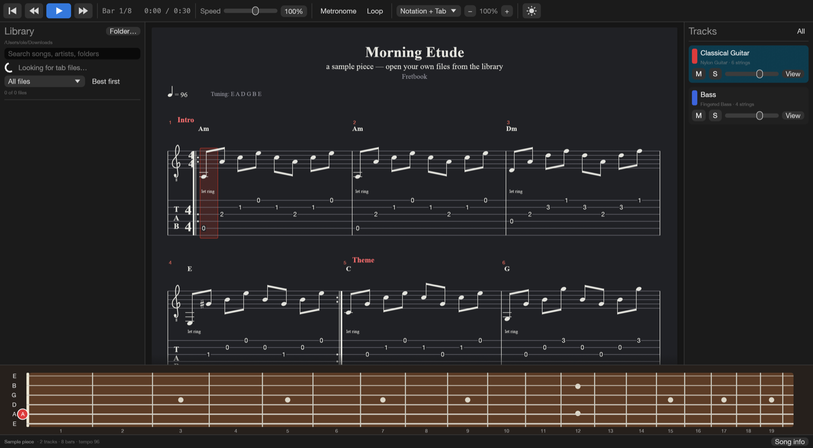

# Fretbook

[](https://github.com/olexale/fretbook/actions/workflows/ci.yml)

A desktop app for reading and playing guitar tabs. Open a Guitar Pro 3 or 4 file (`.gp3`, `.gp4`) and Fretbook shows it as standard notation and tablature, plays it back with sampled instruments, and shows each note on a fretboard as it plays.



## Features

- **Notation and tab.** Shows standard notation, tablature, or both. Includes chord names, section markers, repeats, alternate endings, bends, slides, harmonics, let ring and other techniques.
- **Playback.** Uses a built-in General MIDI sound bank, so there's nothing extra to install. Playback has adjustable speed, a metronome, looping over selected bars, and per-track mute, solo and volume.
- **Fretboard.** Shows the notes that are playing on the current track.
- **Library.** Scans a folder for tab files. You can search by song, artist or folder, and rate files from 1 to 5 stars.
- **Export.** Prints or saves a vector PDF (A4 or Letter), or exports a Standard MIDI File.
- Light and dark themes, plus a native menu bar on macOS.

## Building

You need a recent stable [Rust](https://rustup.rs) toolchain.

```sh
cargo run --release                 # opens with a short sample piece
cargo run --release -- path/to/song.gp4
```

The sound bank (about 32 MB) is compiled into the binary, so the built app is a single self-contained executable.

On Linux, you also need the ALSA development headers (`libasound2-dev` and `pkg-config` on Debian/Ubuntu).

Fretbook is developed mainly on macOS. CI also builds it on Linux. Windows should work but is untested. PDF export takes its fonts from the system (Arial and Times New Roman on macOS).

## Keyboard shortcuts

| Key | Action |
| --- | --- |
| Space | Play / pause |
| ← → | Previous / next bar |
| ↑ ↓ | Previous / next track |
| Home | Back to the start |
| ⌘/Ctrl O | Open a file |
| ⌘/Ctrl P | Print |
| ⌘/Ctrl I | Song information |
| ⌘/Ctrl E | Export as MIDI |
| ⌘/Ctrl 1 / 2 / 3 | Notation + tab / tab only / notation only |
| ⌘/Ctrl = / − / 0 | Zoom in / out / actual size |
| 1–5 | Rate the open file (0 clears the rating) |
| Click a note | Start playing from there |
| Shift-click | Select bars to loop |

You can also drag a file onto the window to open it.

## Limitations

- Fretbook can't read Guitar Pro 5+ files (`.gp5`, `.gpx`, `.gp`) yet, or very old version 1/2 files.
- It's a viewer and player only, so you can't edit tabs.

## Developer flags

```sh
fretbook --scan files.txt          # parse every path listed in files.txt and report errors
fretbook --render song.gp4 out.wav # render the first 30 s of playback to a WAV file
fretbook --screenshot out.png      # start, render one frame to a PNG, and quit
```

## License

The code is released under the [MIT License](LICENSE).

The bundled sound bank, [GeneralUser GS](https://www.schristiancollins.com/generaluser) by S. Christian Collins, has its own license, included at [assets/soundbank/LICENSE.txt](assets/soundbank/LICENSE.txt).

Guitar Pro is a trademark of Arobas Music. Fretbook isn't affiliated with or endorsed by Arobas Music. It reads the file format based on public descriptions of the binary layout.
